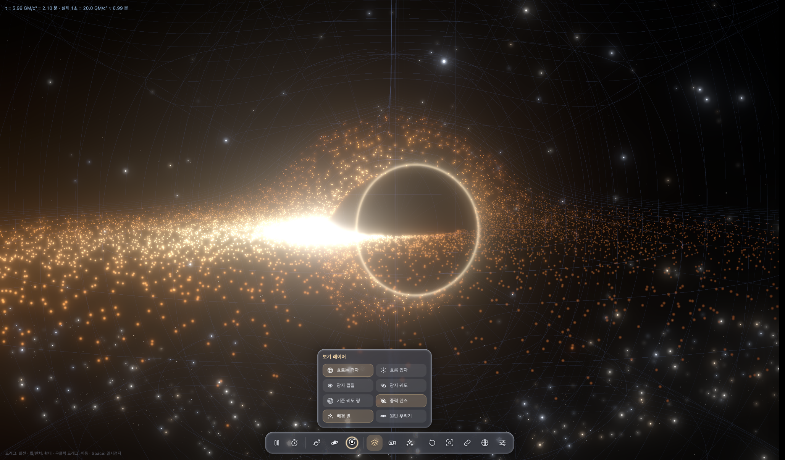

# 블랙홀 시뮬레이터

[English](README.md) · **한국어**

회전하는(Kerr) 블랙홀을 브라우저에서 실시간으로 보여주는 시뮬레이터예요. 시공간이 강물처럼 블랙홀로 흘러드는 모습, 행성이 조석력에 찢겨 강착 원반이 되는 과정, D자 그림자를 둘러싼 광자 껍질 안에서 빛이 도는 모습을 볼 수 있어요.

**바로 보기:** https://madplayer-inc.github.io/blackhole-simulator/



## 기능

- **흐르는 시공간 격자** — Kerr 블랙홀의 "강물 모형". 공간이 각운동량 0인 정확한 측지선을 따라 떨어져 지평선에서 광속에 이르고, 프레임 드래깅으로 꼬여요. 실제 Kerr 값을 쓰고, 과장 배율 슬라이더도 있어요.
- **조석 파괴** — 행성이 조석 반경에 다가가면 라그랑주점으로 질량이 새고, 이어서 파편 수천 개로 부서져요. 파편은 늘어나며 원반으로 정리되고, ISCO 안쪽으로 나선을 그리며 떨어집니다.
- **정확한 Kerr 그림자와 광자 껍질** — Bardeen 임계 곡선으로 스핀과 관측 각도에 맞는 D자 그림자를 그리고, 광자는 정확한 구면 광자 궤도를 따라 움직여요.
- **중력 렌즈** — 별, 파편, 행성의 1차 상과 2차 상. 도플러 비밍과 중력 적색편이도 반영해요.
- **지수형 시간 조절** — 실제 1초를 10⁻² ~ 10⁴ GM/c³로 조절할 수 있어요.
- **현실 단위** — 실제 질량(항성질량, 궁수자리 A\*, M87\*) 기준의 지평선 크기, ISCO 공전 주기, 호킹 온도, 증발 시간, 조석 반경을 보여줘요.
- **글래스 dock** — 아이콘에 마우스를 올리면 그 아래에 작은 중력 렌즈가 생겨요. 장면·카메라 프리셋, 공유 링크, 스크린샷도 여기서 써요.
- **한국어·영어** — 브라우저 언어를 자동으로 따라가요. dock에서 바꾸거나 주소 뒤에 `?lang=ko` / `?lang=en`을 붙여도 돼요.
- WebGL2를 지원하는 데스크톱·모바일 브라우저에서 동작해요.

## 조작

| 입력 | 동작 |
|---|---|
| 드래그 | 회전 |
| 휠 / 핀치 | 확대·축소 |
| 우클릭 드래그 | 이동 |
| Space | 일시정지 / 재생 |
| Dock | 재생, 시간 배율, 행성 투입, 질량, 스핀, 레이어, 카메라, 장면, 처음부터, 스크린샷, 공유, 언어, 상세 설정 |

## 로컬 실행

```bash
npm install
npm run dev      # 개발 서버
npm run build    # 타입 검사 + 프로덕션 빌드 (dist/)
```

Node.js 20 이상이 필요해요.

## 배포

`main`에 push하면 [`.github/workflows/deploy.yml`](.github/workflows/deploy.yml)이 사이트를 빌드해 GitHub Pages에 올려요. 자세한 내용은 [`docs/deploy.md`](docs/deploy.md)에 있어요.

## 물리 모델과 근사

블랙홀 반경, 그림자, 광자 궤도, 시공간 흐름은 정확한 Kerr 식을 써요. 입자 궤도는 중력자기 항을 더한 의사뉴턴 퍼텐셜로 계산하고, 원반이 만들어지는 과정은 단순 규칙으로 대신해요. 중력 렌즈는 얇은 점 렌즈 근사예요. 자세한 식과 검증 값은 [`docs/physics.md`](docs/physics.md)에 정리했어요.

## 기술 스택

TypeScript, Vite, [three.js](https://threejs.org) (MIT), [Tweakpane](https://tweakpane.github.io/docs/) (MIT). 아이콘은 이 프로젝트용으로 직접 그렸어요.
