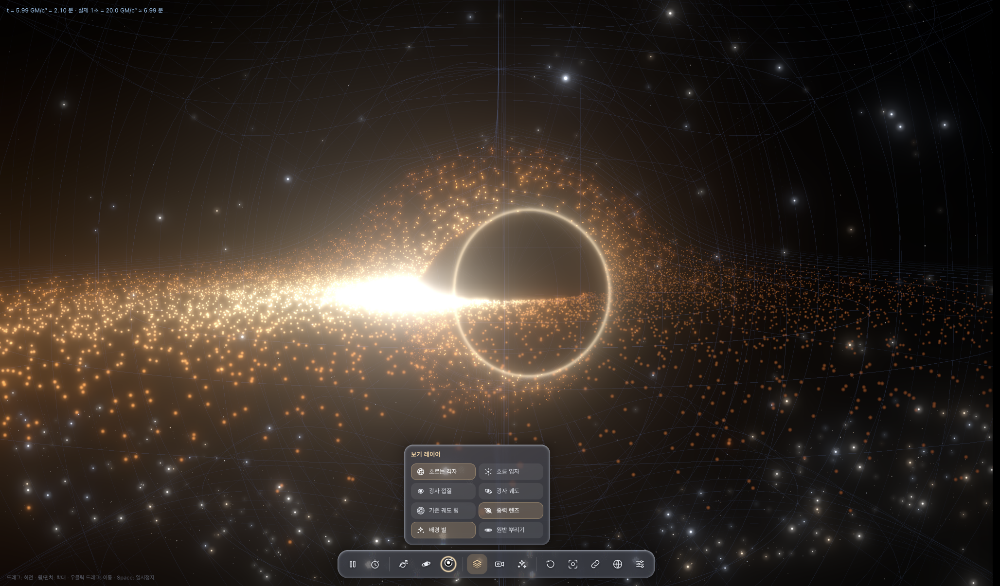

# Black Hole Simulator

**English** · [한국어](README.ko.md)

A real-time, in-browser simulator of a spinning (Kerr) black hole. Watch spacetime flow into the hole like a river, planets get torn apart by tides and turn into an accretion disk, and light circle inside the photon shell around a D-shaped shadow.

**Live:** https://madplayer-inc.github.io/blackhole-simulator/



## Features

- **Flowing spacetime lattice** — the "river model" of a Kerr black hole: space falls in along exact zero-angular-momentum geodesics, reaching the speed of light at the horizon, and is twisted by frame dragging (exact Kerr value, with an optional exaggeration slider).
- **Tidal disruption** — planets shed mass through their Lagrange points near the tidal radius, then break into thousands of fragments that stretch, circularize into an accretion disk, and spiral in past the ISCO.
- **Exact Kerr shadow and photon shell** — the Bardeen critical curve gives the D-shaped shadow for any spin and viewing angle; photons travel along exact spherical photon orbits.
- **Gravitational lensing** of stars, debris and planets (primary and secondary images), Doppler beaming and gravitational redshift.
- **Exponential time control** — one real second can be 10⁻² to 10⁴ GM/c³.
- **Real units** — horizon size, ISCO period, Hawking temperature, evaporation time and tidal radii for real masses (stellar, Sgr A\*, M87\*).
- **Glass dock** with a tiny gravitational lens under the hovered icon, scene presets, camera presets, share links and screenshots.
- **English and Korean** — auto-detected; switch in the dock or with `?lang=en` / `?lang=ko`.
- Works on desktop and mobile browsers with WebGL2.

## Controls

| Input | Action |
|---|---|
| Drag | Rotate |
| Wheel / pinch | Zoom |
| Right-drag | Pan |
| Space | Pause / resume |
| Dock | Play, time scale, launch a planet, mass, spin, layers, camera, scenes, restart, screenshot, share, language, settings |

## Run locally

```bash
npm install
npm run dev      # development server
npm run build    # type-check + production build into dist/
```

Requires Node.js 20 or later.

## Deployment

Every push to `main` builds the site and publishes it to GitHub Pages through [`.github/workflows/deploy.yml`](.github/workflows/deploy.yml). See [`docs/deploy.md`](docs/deploy.md).

## Physics and approximations

The black hole radii, shadow, photon orbits and spacetime flow use exact Kerr formulas. Particle dynamics use a pseudo-Newtonian potential with a gravitomagnetic term, disk formation is phenomenological, and lensing uses a thin point-lens approximation. Details and validation numbers are in [`docs/physics.md`](docs/physics.md) (Korean).

## Tech stack

TypeScript, Vite, [three.js](https://threejs.org) (MIT), [Tweakpane](https://tweakpane.github.io/docs/) (MIT). Icons are drawn for this project.
